# Medora — Entity Relationship Diagram (ERD)

> Versi 1.0 · Database: MySQL/MariaDB · Konvensi: `id BIGINT UNSIGNED PK`, timestamps di semua tabel, `deleted_at` (soft delete) pada master data, nominal Rupiah `BIGINT`, waktu disimpan UTC.
> Status: Implemented — 28 migration files / 27 business tables, verified via `migrate:fresh --seed`.

---

## 1. Diagram (Mermaid)

```mermaid
erDiagram
    PATIENTS ||--o{ ENCOUNTERS : has
    PATIENTS ||--o{ PATIENT_ALLERGIES : has
    DEPARTMENTS ||--o{ ENCOUNTERS : hosts
    DOCTORS ||--o{ ENCOUNTERS : examines
    USERS ||--o| DOCTORS : is
    DOCTORS ||--o{ DOCTOR_SCHEDULES : has

    ENCOUNTERS ||--o{ QUEUES : generates
    ENCOUNTERS ||--o| VITAL_SIGNS : has
    ENCOUNTERS ||--o| CLINICAL_NOTES : has
    CLINICAL_NOTES ||--o{ CLINICAL_NOTE_AMENDMENTS : amended_by
    ENCOUNTERS ||--o{ DIAGNOSES : has
    ICD10_CODES ||--o{ DIAGNOSES : codes
    ENCOUNTERS ||--o{ ENCOUNTER_PROCEDURES : has
    SERVICES ||--o{ ENCOUNTER_PROCEDURES : defines

    ENCOUNTERS ||--o{ PRESCRIPTIONS : has
    PRESCRIPTIONS ||--o{ PRESCRIPTION_ITEMS : contains
    MEDICINES ||--o{ PRESCRIPTION_ITEMS : prescribed_in
    MEDICINES ||--o{ STOCK_MOVEMENTS : moved_by

    ENCOUNTERS ||--o{ LAB_ORDERS : has
    LAB_ORDERS ||--o{ LAB_ORDER_ITEMS : contains
    LAB_TESTS ||--o{ LAB_ORDER_ITEMS : ordered_as
    LAB_TESTS ||--o{ LAB_TEST_PARAMETERS : has
    LAB_ORDER_ITEMS ||--o{ LAB_RESULTS : produces

    ENCOUNTERS ||--|| INVOICES : billed_by
    INVOICES ||--o{ INVOICE_ITEMS : contains
    INVOICES ||--o{ PAYMENTS : paid_by

    PATIENTS ||--o{ MEDICAL_RECORD_ACCESS_LOGS : accessed_in
    USERS ||--o{ MEDICAL_RECORD_ACCESS_LOGS : accesses

    PATIENTS {
        bigint id PK
        string medical_record_number UK
        string nik UK "nullable"
        string name
        date birth_date
        string birth_place
        enum gender "male|female"
        text address
        string phone
        string blood_type "nullable"
        string occupation "nullable"
        string guardian_name "nullable"
        string guardian_phone "nullable"
        timestamp deleted_at
    }

    PATIENT_ALLERGIES {
        bigint id PK
        bigint patient_id FK
        string allergen
        enum severity "mild|moderate|severe"
        text notes
        bigint recorded_by FK "users.id"
    }

    DEPARTMENTS {
        bigint id PK
        string name
        string queue_code UK "mis. U, G"
        boolean is_active
        timestamp deleted_at
    }

    DOCTORS {
        bigint id PK
        bigint user_id FK
        string sip_number
        string str_number
        string specialization "nullable"
        bigint default_department_id FK
        timestamp deleted_at
    }

    DOCTOR_SCHEDULES {
        bigint id PK
        bigint doctor_id FK
        bigint department_id FK
        tinyint day_of_week "1-7"
        time start_time
        time end_time
        int quota "nullable"
        boolean is_active
    }

    ENCOUNTERS {
        bigint id PK
        uuid uuid UK "untuk URL"
        bigint patient_id FK
        bigint department_id FK
        bigint doctor_id FK
        date encounter_date
        enum visit_type "new|follow_up"
        enum payer_type "self|insurance_manual"
        enum status "registered|nurse_assessment|in_consultation|waiting_lab|in_pharmacy|waiting_payment|completed|cancelled"
        text cancellation_reason "nullable"
        bigint registered_by FK "users.id"
        timestamp completed_at "nullable"
    }

    QUEUES {
        bigint id PK
        bigint encounter_id FK
        enum queue_type "poli|pharmacy"
        enum sub_type "nullable: racikan|non_racikan"
        bigint department_id FK "nullable"
        string queue_number "mis. U-012"
        int sequence
        date queue_date
        enum status "waiting|called|serving|done|skipped"
        timestamp called_at "nullable"
        timestamp served_at "nullable"
        timestamp finished_at "nullable"
        bigint handled_by FK "nullable users.id"
    }

    VITAL_SIGNS {
        bigint id PK
        bigint encounter_id FK
        smallint systolic "mmHg"
        smallint diastolic "mmHg"
        smallint pulse "x/menit"
        decimal temperature "celsius 4,1"
        smallint respiratory_rate
        smallint spo2 "persen"
        decimal weight_kg "5,2"
        decimal height_cm "5,2"
        text chief_complaint
        bigint recorded_by FK "users.id"
    }

    CLINICAL_NOTES {
        bigint id PK
        bigint encounter_id FK
        text subjective
        text objective
        text assessment
        text plan
        enum status "draft|final"
        timestamp finalized_at "nullable"
        bigint finalized_by FK "nullable doctors.id"
    }

    CLINICAL_NOTE_AMENDMENTS {
        bigint id PK
        bigint clinical_note_id FK
        text content
        bigint created_by FK "users.id"
        timestamp created_at
    }

    ICD10_CODES {
        bigint id PK
        string code UK
        string description_en
        string description_id "nullable"
    }

    DIAGNOSES {
        bigint id PK
        bigint encounter_id FK
        bigint icd10_code_id FK
        enum type "primary|secondary"
        text notes "nullable"
    }

    SERVICES {
        bigint id PK
        string name
        enum category "consultation|procedure|administration|lab"
        string icd9cm_code "nullable"
        bigint price
        boolean is_active
        timestamp deleted_at
    }

    ENCOUNTER_PROCEDURES {
        bigint id PK
        bigint encounter_id FK
        bigint service_id FK
        string service_name_snapshot
        bigint price_snapshot
        smallint quantity
        bigint performed_by FK "users.id"
    }

    MEDICINES {
        bigint id PK
        string name
        string generic_name "nullable"
        string unit "tablet|kapsul|ml|..."
        string dosage_form "nullable"
        bigint selling_price
        int stock_quantity "derived, cache"
        int minimum_stock
        boolean is_active
        timestamp deleted_at
    }

    STOCK_MOVEMENTS {
        bigint id PK
        bigint medicine_id FK
        enum type "in|out|adjustment"
        int quantity "signed"
        bigint unit_cost "nullable, untuk in"
        date expired_date "nullable, untuk in"
        string reference_type "nullable polymorphic"
        bigint reference_id "nullable"
        text reason "wajib untuk adjustment"
        bigint created_by FK "users.id"
    }

    PRESCRIPTIONS {
        bigint id PK
        bigint encounter_id FK
        enum status "submitted|verified|flagged|dispensed|handed_over"
        text flag_notes "nullable"
        bigint verified_by FK "nullable users.id"
        bigint dispensed_by FK "nullable users.id"
        timestamp dispensed_at "nullable"
    }

    PRESCRIPTION_ITEMS {
        bigint id PK
        bigint prescription_id FK
        bigint medicine_id FK
        string medicine_name_snapshot
        bigint price_snapshot
        int quantity
        string dosage "mis. 3x1"
        string instruction "signa, sesudah makan"
        boolean is_racikan
        text racikan_instruction "nullable"
    }

    LAB_TESTS {
        bigint id PK
        string name
        bigint price
        boolean is_active
        timestamp deleted_at
    }

    LAB_TEST_PARAMETERS {
        bigint id PK
        bigint lab_test_id FK
        string parameter_name
        string unit
        string normal_range_male "nullable"
        string normal_range_female "nullable"
    }

    LAB_ORDERS {
        bigint id PK
        bigint encounter_id FK
        enum status "ordered|in_progress|resulted"
        bigint ordered_by FK "doctors.id"
        timestamp resulted_at "nullable"
    }

    LAB_ORDER_ITEMS {
        bigint id PK
        bigint lab_order_id FK
        bigint lab_test_id FK
        string test_name_snapshot
        bigint price_snapshot
    }

    LAB_RESULTS {
        bigint id PK
        bigint lab_order_item_id FK
        bigint lab_test_parameter_id FK
        string value
        string unit_snapshot
        string normal_range_snapshot
        enum flag "normal|high|low"
        bigint amends_result_id FK "nullable, self-ref"
        bigint entered_by FK "users.id"
    }

    INVOICES {
        bigint id PK
        string invoice_number UK
        bigint encounter_id FK
        enum status "draft|waiting_payment|paid|void"
        bigint subtotal
        bigint discount_amount
        text discount_reason "nullable"
        bigint total
        bigint voided_by FK "nullable users.id"
        text void_reason "nullable"
    }

    INVOICE_ITEMS {
        bigint id PK
        bigint invoice_id FK
        enum category "registration|consultation|procedure|lab|medicine"
        string item_name_snapshot
        bigint unit_price_snapshot
        smallint quantity
        bigint line_total
        string reference_type "nullable polymorphic"
        bigint reference_id "nullable"
    }

    PAYMENTS {
        bigint id PK
        bigint invoice_id FK
        enum method "cash|transfer|qris_static"
        bigint amount
        bigint amount_tendered "nullable, tunai"
        bigint change_amount "nullable"
        bigint received_by FK "users.id"
        timestamp paid_at
    }

    MEDICAL_RECORD_ACCESS_LOGS {
        bigint id PK
        bigint user_id FK
        bigint patient_id FK
        bigint encounter_id FK "nullable"
        string context "halaman/aksi"
        boolean is_break_the_glass
        text access_reason "nullable, wajib jika BTG"
        timestamp accessed_at
    }

    USERS {
        bigint id PK
        string name
        string email UK
        string password
        boolean is_active
        timestamp deleted_at
    }
```

> Tabel spatie (`roles`, `permissions`, `model_has_roles`, dst.), `settings`, dan `activity_log` tidak digambarkan — mengikuti struktur bawaan package.

---

## 2. Catatan Desain per Kelompok Tabel

### 2.1 Inti Klinis — `patients` → `encounters`

- **`encounters` adalah tabel sentral.** Semua record klinis dan finansial ber-FK ke `encounters`, bukan langsung ke `patients`. Riwayat pasien = daftar encounter miliknya.
- `encounters.uuid` dipakai di URL (route model binding) agar ID sekuensial tidak terekspos — relevan untuk privasi data kesehatan.
- `visit_type` dan `payer_type` disimpan di encounter (bukan pasien) karena bisa berbeda tiap kunjungan.
- Alergi di `patient_allergies` (level pasien, bukan encounter) — sekali tercatat berlaku selamanya sampai dikoreksi.

### 2.2 Antrian — `queues`

- Satu tabel untuk semua stage; `queue_type` membedakan poli vs farmasi. Menambah stage baru (mis. antrian lab) = menambah enum, bukan tabel baru.
- `sequence` (int per poli per hari) untuk pengurutan; `queue_number` (string) untuk display.
- Unique constraint: (`queue_type`, `department_id`, `queue_date`, `sequence`).
- Timestamp per transisi (`called_at`, `served_at`, `finished_at`) menjadi sumber metrik waktu tunggu tanpa tabel tambahan.

### 2.3 Catatan Klinis — Immutability

- `clinical_notes.status = final` menjadi guard di Policy/Action: **tidak ada** endpoint update setelah final. Koreksi masuk `clinical_note_amendments` (append-only).
- `diagnoses` mengikuti aturan yang sama: setelah note final, diagnosa terkunci; perubahan lewat addendum + diagnosa baru bertanda.
- `lab_results` immutable dengan pola self-reference: hasil koreksi adalah baris baru dengan `amends_result_id` menunjuk hasil lama.

### 2.4 Farmasi — Stok Append-Only

- `medicines.stock_quantity` hanyalah **cache** (denormalisasi untuk tampilan cepat); sumber kebenaran adalah `SUM(stock_movements.quantity)`. Sediakan command rekonsiliasi.
- `stock_movements` polymorphic reference: `out` menunjuk `prescription_items`, `in` menunjuk pembelian, `adjustment` wajib alasan.
- Batch/expired tracking sederhana di level movement `in`; FEFO penuh (per-batch dispensing) ditunda ke fase 2 agar MVP ramping.

### 2.5 Billing — Snapshot Everywhere

- Setiap `invoice_items` menyimpan `item_name_snapshot` + `unit_price_snapshot` — perubahan tarif master tidak pernah mengubah tagihan lama.
- `invoice_items.reference_type/reference_id` (polymorphic) menghubungkan item ke sumbernya (`encounter_procedures`, `prescription_items`, `lab_order_items`) untuk auditabilitas.
- Void = perubahan status + alasan; tidak ada delete. Pembayaran salah dikoreksi dengan reversal, bukan edit.

### 2.6 Audit — `medical_record_access_logs`

- Append-only murni: tidak ada endpoint update/delete, tidak ada soft delete. Ditulis via middleware/listener setiap halaman berisi data klinis dibuka.
- `is_break_the_glass = true` mewajibkan `access_reason`; muncul di laporan khusus petugas RM.
- Volume tabel ini akan besar — index (`patient_id`, `accessed_at`) dan (`user_id`, `accessed_at`); pertimbangkan partisi per tahun sejak awal.

### 2.7 Indexing Penting

| Tabel | Index |
|---|---|
| patients | `medical_record_number` (unique), `nik` (unique nullable), fulltext/prefix `name`, `birth_date` |
| encounters | (`patient_id`, `encounter_date`), (`department_id`, `encounter_date`, `status`), (`doctor_id`, `encounter_date`) |
| queues | (`queue_type`, `department_id`, `queue_date`, `status`), unique sequence per hari |
| icd10_codes | `code`, prefix index `description_*` untuk autocomplete |
| stock_movements | (`medicine_id`, `created_at`) |
| invoice_items | (`invoice_id`), (`reference_type`, `reference_id`) |
| medical_record_access_logs | (`patient_id`, `accessed_at`), (`user_id`, `accessed_at`) |

### 2.8 Kesiapan FHIR (Fase 2, Tanpa Restrukturisasi)

Pemetaan yang sudah disiapkan oleh desain ini bila kelak integrasi SATUSEHAT dibutuhkan:

| Tabel | Resource FHIR |
|---|---|
| patients | Patient |
| encounters | Encounter |
| vital_signs | Observation (per field → per Observation) |
| diagnoses + icd10_codes | Condition |
| prescriptions / prescription_items | MedicationRequest / MedicationDispense |
| lab_orders / lab_results | ServiceRequest / Observation (laboratory) |
| encounter_procedures | Procedure |

Cukup menambah kolom `satusehat_id` (nullable) di tabel terkait + tabel outbox antrian kirim — tidak perlu mengubah struktur inti.
